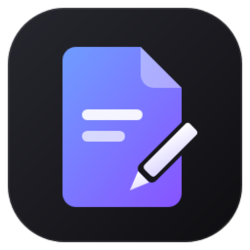
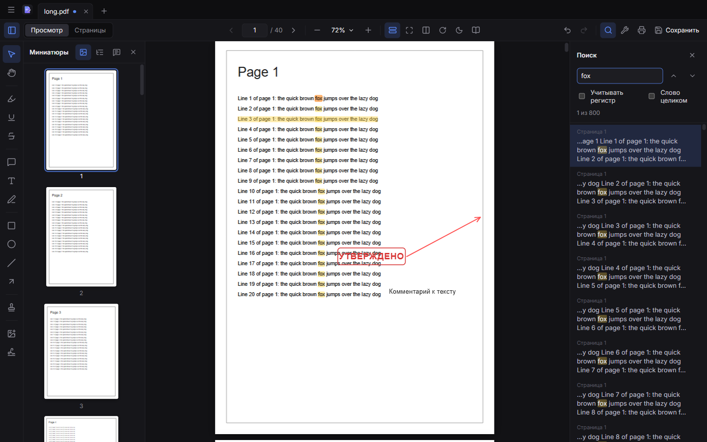
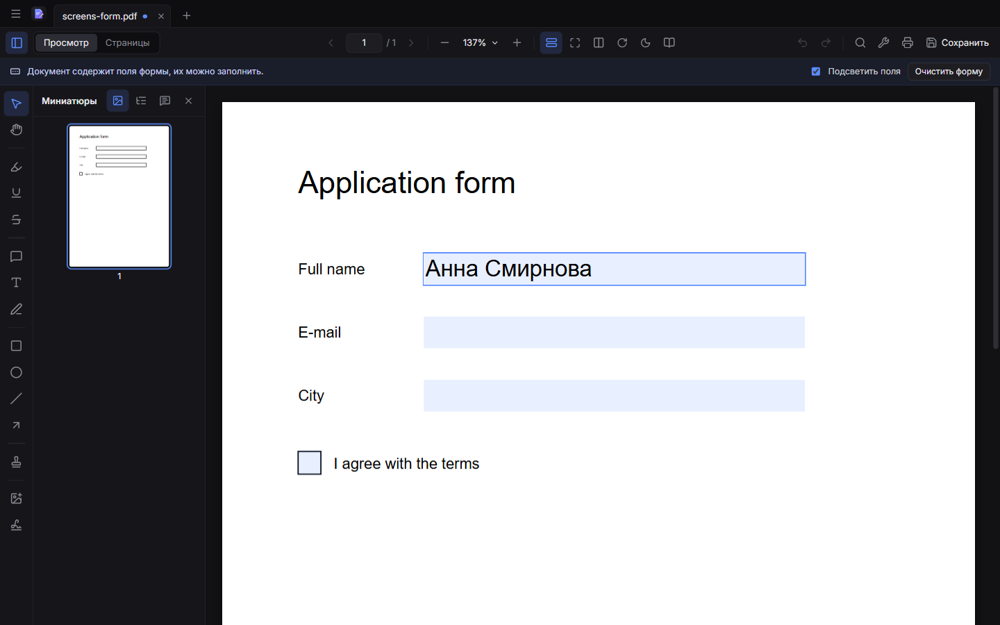
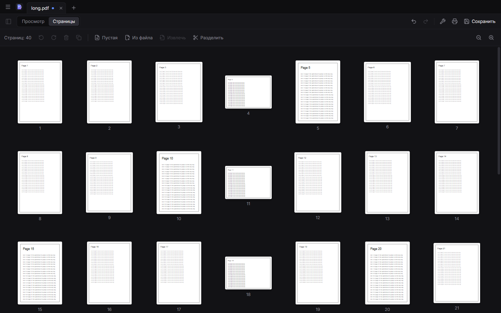
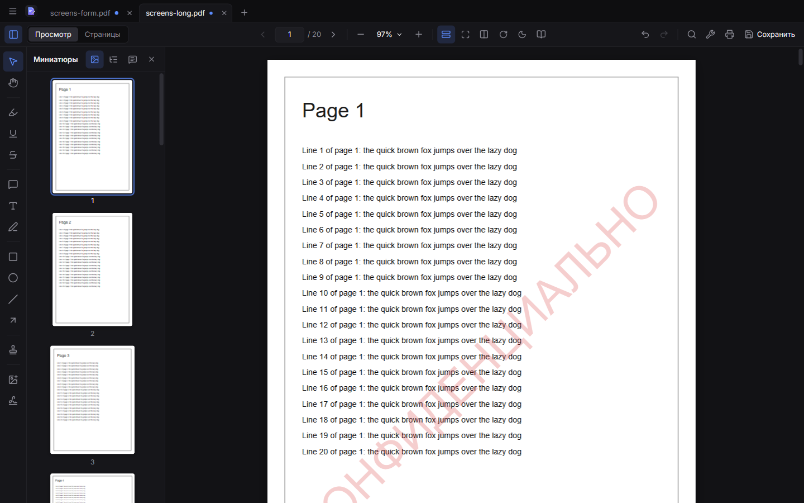
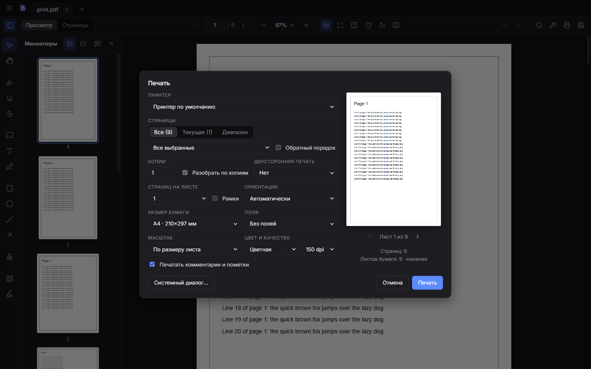
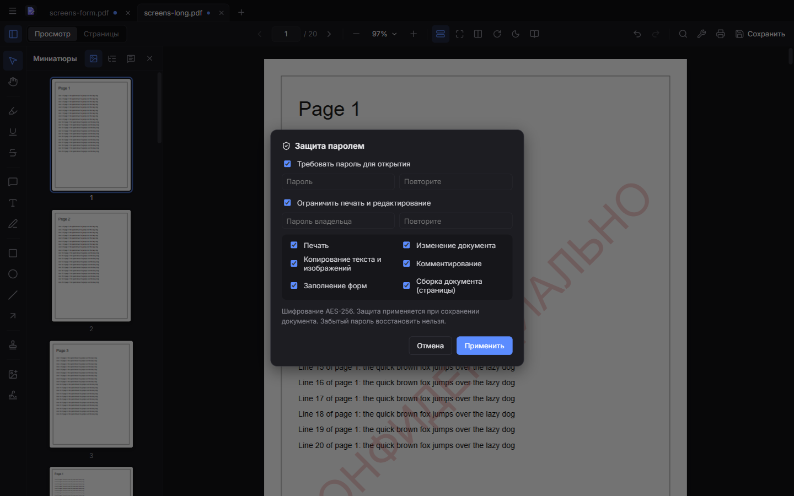

<div align="center">



# PDF Studio

**Бесплатный тёмный PDF-ридер и редактор для Windows**

Читайте, комментируйте, заполняйте формы, подписывайте, собирайте и защищайте PDF — без подписки, без регистрации и без интернета.

<sub>A free, offline, dark-themed PDF reader and editor for Windows. The interface is in Russian.</sub>

<br>


[**Скачать**](../../releases/latest) · [Возможности](#возможности) · [Горячие клавиши](#горячие-клавиши) · [Сборка из исходников](#сборка-из-исходников)

<br>



</div>

## Почему PDF Studio

- **Плавная прокрутка без скачков.** Размеры всех страниц известны заранее, поэтому документ на сотни страниц прокручивается попиксельно и никогда не «прыгает» на другую страницу.
- **Всё нужное в одном окне.** Аннотации, формы, подписи, водяные знаки, нумерация, перестановка страниц, пароли и печать.
- **Совместимо с другими программами.** Комментарии сохраняются как стандартные PDF-аннотации, их видно в Acrobat, Chrome и Edge.
- **Приватно.** Программа работает офлайн и никуда не отправляет ваши файлы.

## Установка

1. Откройте страницу [**Releases**](../../releases/latest) и скачайте `pdf-studio-<версия>-setup.exe`.
2. Запустите установщик и выберите папку установки.
3. Чтобы PDF-файлы открывались в PDF Studio по двойному щелчку, выберите программу в меню «Открыть с помощью».

> [!NOTE]
> Установщик не подписан сертификатом, поэтому Windows SmartScreen может показать предупреждение «Windows защитил ваш компьютер».
> Нажмите **Подробнее**, затем **Выполнить в любом случае**.

## Возможности

<table>
<tr>
<td width="50%"></td>
<td width="50%"></td>
</tr>
<tr>
<td align="center"><sub>Заполнение форм, кириллица поддерживается</sub></td>
<td align="center"><sub>Перестановка и сборка страниц</sub></td>
</tr>
<tr>
<td width="50%"></td>
<td width="50%"></td>
</tr>
<tr>
<td align="center"><sub>Водяные знаки и колонтитулы</sub></td>
<td align="center"><sub>Своё окно печати с предпросмотром</sub></td>
</tr>
</table>

### 📖 Чтение и навигация

- Непрерывная прокрутка, разворот, поворот вида, ночной режим страниц, полноэкранное чтение.
- Масштаб: по ширине, страница целиком, 100 %, пресеты, Ctrl + колесо или щипок. Точка под курсором остаётся на месте.
- Боковая панель: миниатюры, закладки (оглавление) и список комментариев.
- Поиск с подсветкой, учётом регистра и поиском целых слов.
- Выделение и копирование текста, внутренние и внешние ссылки.
- Вкладки документов, недавние файлы, перетаскивание файлов в окно, «Открыть с помощью».
- Свойства документа и открытие файлов с паролем.

### ✏️ Комментарии и аннотации

- Выделение, подчёркивание и зачёркивание текста.
- Заметки, текстовые поля, рисование от руки.
- Прямоугольник, эллипс, линия, стрелка, штампы («Утверждено» и другие).
- Каждую аннотацию можно выбрать, переместить, изменить размер, цвет, прозрачность и толщину.
- Отмена и повтор действий (Ctrl+Z / Ctrl+Y).

### 📄 Страницы

- Перестановка перетаскиванием, поворот, удаление, дублирование.
- Вставка пустых страниц и страниц из другого PDF.
- Извлечение страниц, разделение документа, объединение нескольких файлов в один.

### 📝 Формы и подписи

- **Формы AcroForm:** текстовые поля, флажки, переключатели, списки. Можно подсветить поля, очистить форму или сохранить копию со «сглаженной» формой.
- **Подписи:** нарисованная, набранная рукописным шрифтом или загруженная из файла. Подписи запоминаются для повторного использования.
- **Изображения:** PNG и JPEG, а также WebP, GIF и BMP. После повторного открытия файла их можно редактировать.

### 🏷️ Оформление

- **Водяной знак:** текст или картинка. Настраиваются размер, цвет, прозрачность, угол, положение и диапазон страниц.
- **Колонтитулы и нумерация:** шесть позиций и подстановки `{page}`, `{total}`, `{date}`, `{file}`.

### 🔒 Защита



- Пароль на открытие и пароль владельца.
- Ограничения: печать, изменение, копирование, комментирование, заполнение форм, сборка.
- Шифрование **AES-256**.
- Открытие защищённых файлов: RC4 40/128, AES-128 и AES-256. Такие файлы можно редактировать, при сохранении защита сохраняется.

<br clear="right">

### 🖨️ Печать

- Все страницы, текущая или диапазон (`1-3, 5, 8-10`); только чётные или нечётные; обратный порядок.
- Количество копий и разбор по копиям.
- Двусторонняя печать на принтере с дуплексом. Для принтеров без дуплекса есть ручной режим: сначала печатаются лицевые стороны, затем программа просит перевернуть стопку.
- 1, 2, 4, 6, 9 или 16 страниц на листе; бумага A3, A4, A5, Letter, Legal; поля и ориентация.
- Масштаб, цветная или чёрно-белая печать, 150 или 300 dpi.
- Настройки запоминаются между запусками. Кнопка «Системный диалог…» открывает стандартное окно печати Windows.

## Горячие клавиши

| Действие                             | Клавиши                                                                                                     |
| ------------------------------------ | ----------------------------------------------------------------------------------------------------------- |
| Открыть / Сохранить / Сохранить как  | <kbd>Ctrl</kbd>+<kbd>O</kbd> / <kbd>Ctrl</kbd>+<kbd>S</kbd> / <kbd>Ctrl</kbd>+<kbd>Shift</kbd>+<kbd>S</kbd> |
| Печать / Закрыть вкладку             | <kbd>Ctrl</kbd>+<kbd>P</kbd> / <kbd>Ctrl</kbd>+<kbd>W</kbd>                                                 |
| Поиск / Следующее / Предыдущее       | <kbd>Ctrl</kbd>+<kbd>F</kbd> / <kbd>F3</kbd> / <kbd>Shift</kbd>+<kbd>F3</kbd>                               |
| Масштаб                              | <kbd>Ctrl</kbd>+<kbd>+</kbd> / <kbd>Ctrl</kbd>+<kbd>−</kbd>                                                 |
| Страница целиком / 100 % / По ширине | <kbd>Ctrl</kbd>+<kbd>0</kbd> / <kbd>Ctrl</kbd>+<kbd>1</kbd> / <kbd>Ctrl</kbd>+<kbd>2</kbd>                  |
| Повернуть вид                        | <kbd>Ctrl</kbd>+<kbd>Shift</kbd>+<kbd>+</kbd> / <kbd>Ctrl</kbd>+<kbd>Shift</kbd>+<kbd>−</kbd>               |
| Отменить / Повторить                 | <kbd>Ctrl</kbd>+<kbd>Z</kbd> / <kbd>Ctrl</kbd>+<kbd>Y</kbd>                                                 |
| Перейти к странице                   | <kbd>Ctrl</kbd>+<kbd>G</kbd>                                                                                |
| Полный экран                         | <kbd>F11</kbd> или <kbd>Ctrl</kbd>+<kbd>L</kbd>                                                             |

**Инструменты:** <kbd>V</kbd> выбор, <kbd>H</kbd> рука, <kbd>E</kbd> выделение, <kbd>U</kbd> подчёркивание, <kbd>K</kbd> зачёркивание, <kbd>N</kbd> заметка, <kbd>T</kbd> текст, <kbd>P</kbd> карандаш, <kbd>R</kbd> прямоугольник, <kbd>O</kbd> эллипс, <kbd>L</kbd> линия, <kbd>A</kbd> стрелка, <kbd>S</kbd> штамп.

## Ограничения

- Подпись — это изображение на странице, а не криптографическая цифровая подпись с сертификатом.
- Файлы, зашифрованные сертификатом (public-key), открываются только для просмотра.
- JavaScript в формах (вычисления, форматирование полей) не выполняется.
- Если документ собран из нескольких файлов, закладки и форма берутся из первого.
- Редактировать уже существующий текст в PDF пока нельзя.

## Сборка из исходников

Нужен [Node.js](https://nodejs.org/) 22 или новее.

```bash
git clone <адрес этого репозитория>
cd pdf-studio
npm install          # также копирует ресурсы pdf.js в src/renderer/public/pdfjs
npm run dev          # запуск в режиме разработки
npm run build:win    # установщик: dist/pdf-studio-<версия>-setup.exe
```

Проверки:

```bash
npm run typecheck    # проверка типов
npm test             # юнит-тесты (Vitest)
npm run e2e          # сборка и e2e-тесты в Electron (Playwright)
```

<details>
<summary><b>Устройство проекта</b></summary>

<br>

| Часть         | Технологии                                |
| ------------- | ----------------------------------------- |
| Оболочка      | Electron, electron-vite, electron-builder |
| Интерфейс     | React, Zustand, Immer, dnd-kit, Lucide    |
| Отрисовка PDF | pdf.js                                    |
| Запись PDF    | pdf-lib, fontkit                          |
| Тесты         | Vitest, Playwright                        |

```
src/
├── main/                 главный процесс Electron: окна, файлы, печать
├── preload/              мост между главным процессом и интерфейсом
└── renderer/src/
    ├── components/       интерфейс; Viewer/ — просмотр страниц
    ├── store/            состояние документа и интерфейса
    └── lib/pdf/          работа с PDF: раскладка, поиск, аннотации,
                          формы, сохранение, шифрование, печать
tests/
├── unit/                 юнит-тесты
└── e2e/                  e2e-тесты в Electron
scripts/                  служебные скрипты
```

Служебные скрипты:

- `node scripts/make-icon.mjs` собирает `resources/icon.ico` и `icon.png` из `resources/icon.svg`.
- `node scripts/make-encrypted-fixtures.mjs` пересоздаёт RC4-фикстуры для тестов шифрования (нужен Python с pypdf).

</details>

## Лицензия

[MIT](LICENSE). Программой можно свободно пользоваться, изменять её и распространять.
